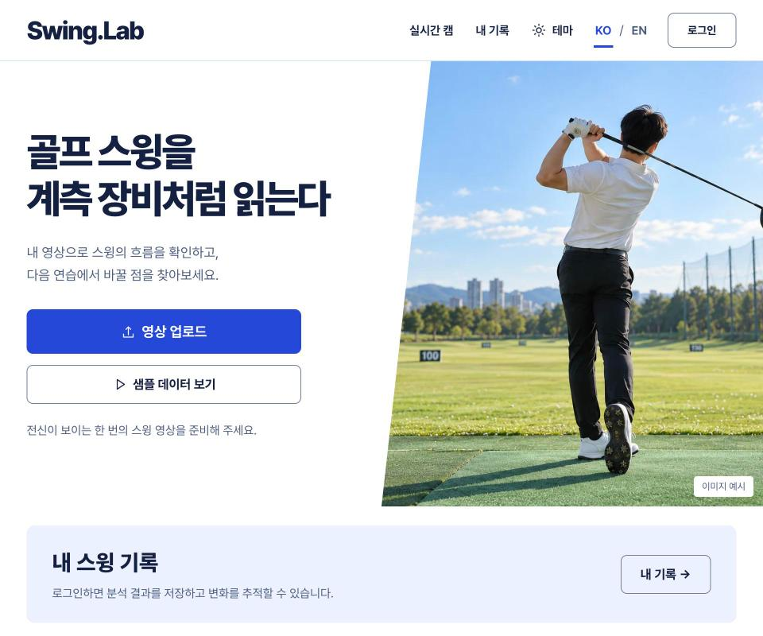
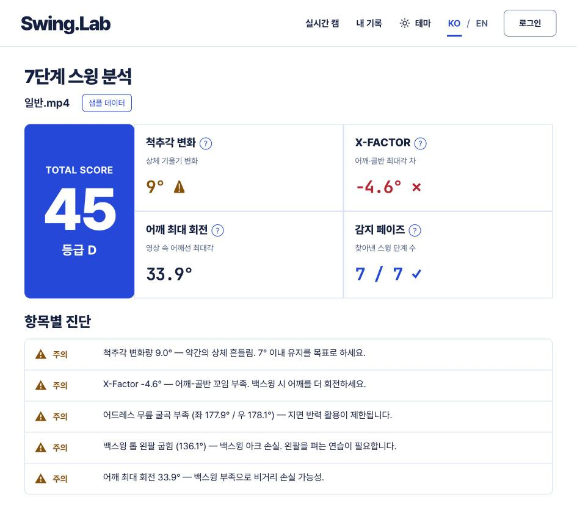
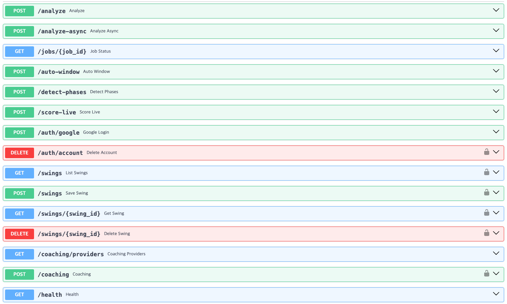

#  Swing.Lab — AI 골프 스윙 분석기

MediaPipe 포즈 추정과 LLM 코칭을 결합해, 골프 스윙 영상 한 편을 7단계로 자동 분할하고
관절 각도·궤적 데이터를 원인→결과→해결책 구조의 코칭 리포트로 바꿔주는 프로젝트입니다.

> 개인 프로젝트 · 미배포(로컬·Docker 실행) · 최신 개발 브랜치는 `dev`

<p align="center">
  
  
</p>
<p align="center"><sub>현재 웹 UI(dev) — 로컬 실행 화면, 2026-10-14 캡처</sub></p>

## 구성

같은 분석 코어(`golf_swing_analyzer/`)를 공유하는 두 개의 프론트엔드가 있습니다.

| | 역할 |
|---|---|
| **`server/` + `web/`** (FastAPI + React) | 메인 앱 — 비동기 분석 API, Google 로그인, 스윙 기록, 한/영 지원 |
| **`golf_swing_analyzer/`** (Streamlit) | 레퍼런스 구현 — 회귀 검증 기준 |

## API 서버 (`server/`)

FastAPI 7개 모듈(`main`·`auth`·`db`·`jobs`·`models`·`ratelimit`·`serialization`), OpenAPI 경로 13개 · 오퍼레이션 15개.

<p align="center"></p>

| 그룹 | 엔드포인트 |
|---|---|
| 분석 | `POST /analyze` · `POST /analyze-async` · `GET /jobs/{job_id}` · `POST /auto-window` · `POST /detect-phases` · `POST /score-live` |
| 인증 | `POST /auth/google` · `DELETE /auth/account` (인증) |
| 스윙 기록 | `GET`·`POST /swings` (인증) · `GET`·`DELETE /swings/{swing_id}` (인증) |
| 코칭·운영 | `GET /coaching/providers` · `POST /coaching` (인증) · `GET /health` |

(인증) = JWT 필요

**설계 결정과 한계**

| 결정 | 이유 | 한계 |
|---|---|---|
| 비동기 작업 큐 + 폴링 (`jobs.py`) | 긴 영상의 동기 처리(HTTP 타임아웃)를 대체 — `job_id` 발급 후 `GET /jobs/{id}`로 단계(uploaded→trimming→analyzing→scoring→done) 조회 | 인메모리·단일 프로세스 전제. 멀티 워커로 가면 Redis/DB 큐로 교체 |
| LLM 키는 서버만 보관 | 공급자별 키를 환경 변수(`GEMINI_API_KEY`·`ANTHROPIC_API_KEY`·`OPENAI_API_KEY`)로만 둠 | 키가 없는 공급자는 503으로 안내 |
| Google 로그인 + 자체 JWT (`auth.py`) | Google ID 토큰을 JWKS(RS256)로 검증 후 HS256 JWT 발급, 비밀번호 저장 없음 | `JWT_SECRET` 미설정 시 재시작마다 세션 무효 |
| IP 슬라이딩 윈도우 레이트리밋 (`ratelimit.py`) | 프록시 뒤 배포 전제로 `X-Forwarded-For` 사용, 키 1만 개 상한 | 직접 노출 시 스푸핑 가능, 단일 프로세스 전제 |
| Docker를 측정 기준 환경으로 | 같은 영상의 어깨 최대 회전이 Windows 64.2° · Mac 54.3° · Docker 72.4°로 달라 비교 기준을 고정 | 수치 비교는 Docker 환경 안에서만 유효 |

## 핵심 기능

- **7단계 스윙 자동 세그먼테이션** — 어드레스 → 백스윙 → 백스윙 톱 → 다운스윙 → 임팩트 → 팔로우스루 → 피니시
- **어깨폭 정규화 좌표계** 기반 관절각 계산 — 카메라 거리·해상도 무관
- **원인→결과→해결책 구조의 AI 코칭 리포트** — Gemini / Claude / GPT
- **자동/수동 스윙 구간 트리밍** — 긴 영상에서도 스윙 구간만 추출
- 웹: 손목 Y 궤적 파형 차트, 한/영 토글, 360·390·1440px 반응형

## 검증

- `pytest`: **104 passed, 1 failed** (2026-10-16, `dev`) — 실패 1건은 스냅샷 회귀 `test_analyzer_snapshot.py::test_ilban_regression`
- 분할 오류 수정(2026-10-12): 일반 영상 임팩트 프레임 167 → 90(수동 참조 89~91), 자동 구간 IoU 일반 0.467 → 0.923 · 프로 0.480 → 0.931.
  남은 실패: 어려운 영상 1건 IoU 0, 프로2 0.348 → 0.000 — 상세는 [`docs/research/phase_diag/AFTER.md`](./docs/research/phase_diag/AFTER.md)

## 실행

```bash
# API 서버
pip install -r server/requirements.txt && cd server && uvicorn main:app --port 8010
# 웹
cd web && npm install && npm run dev        # http://localhost:5173
# Docker (프로덕션 골격 — .env에 JWT_SECRET 등 설정)
docker compose up -d --build                # web :8080 / api 127.0.0.1:8010
# Streamlit 레퍼런스
pip install -r golf_swing_analyzer/requirements.txt && streamlit run golf_swing_analyzer/app_v2.py
```

Android(Capacitor)와 배포 구성은 [`RUNNING.md`](./RUNNING.md) 참고.

## 기술 스택

- **분석 코어**: MediaPipe Pose, OpenCV(CLAHE 전처리), NumPy
- **API 서버**: FastAPI, SQLite(`DATABASE_URL`로 교체 가능), PyJWT
- **웹**: React + Vite + TypeScript, Recharts
- **레퍼런스**: Streamlit
- **인프라**: Dockerfile(server·web) + docker-compose
- **LLM 코칭**: Gemini / Claude / GPT

## 개발 가이드

아키텍처, 알고리즘 불변식, 각 패키지의 역할은 [`CLAUDE.md`](./CLAUDE.md)에 정리돼 있습니다.
Claude Code·Codex에 작업 지시서를 써서 개발하고, 결과는 테스트와 측정으로 검수합니다.
